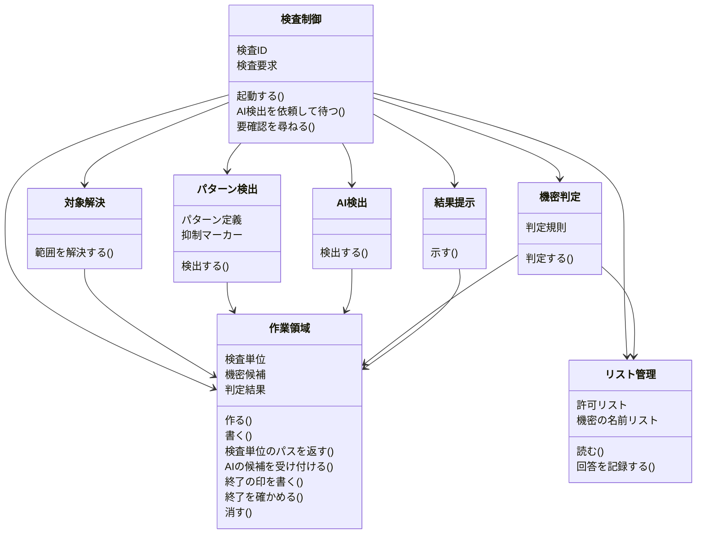
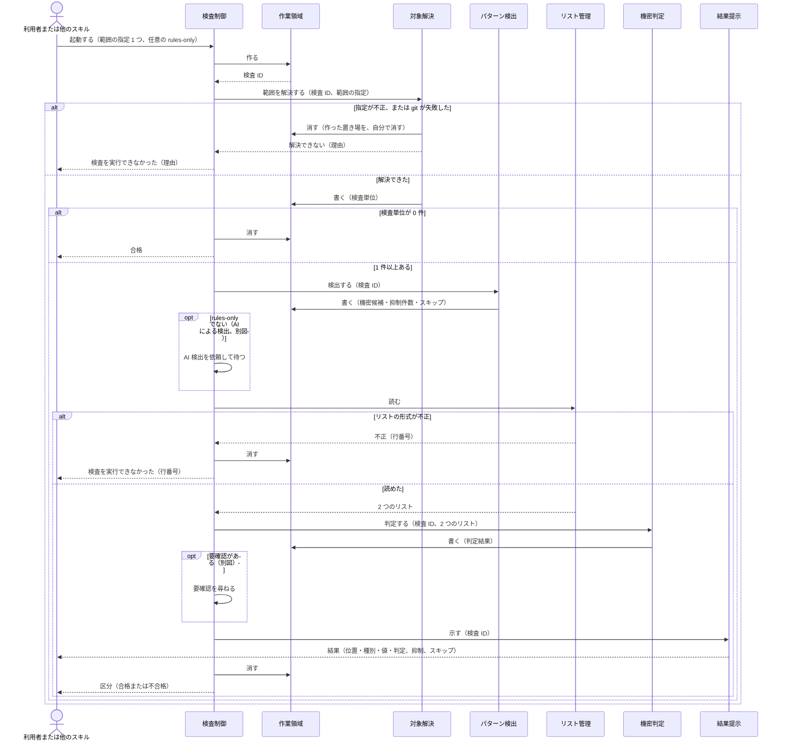
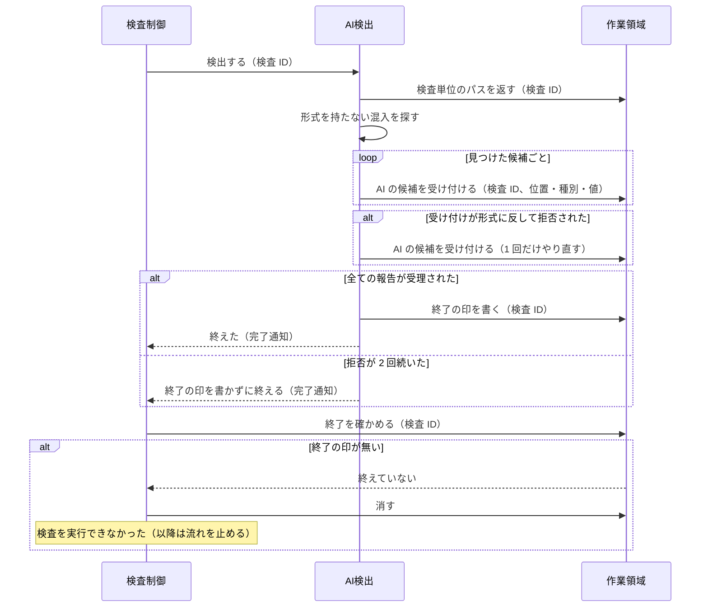
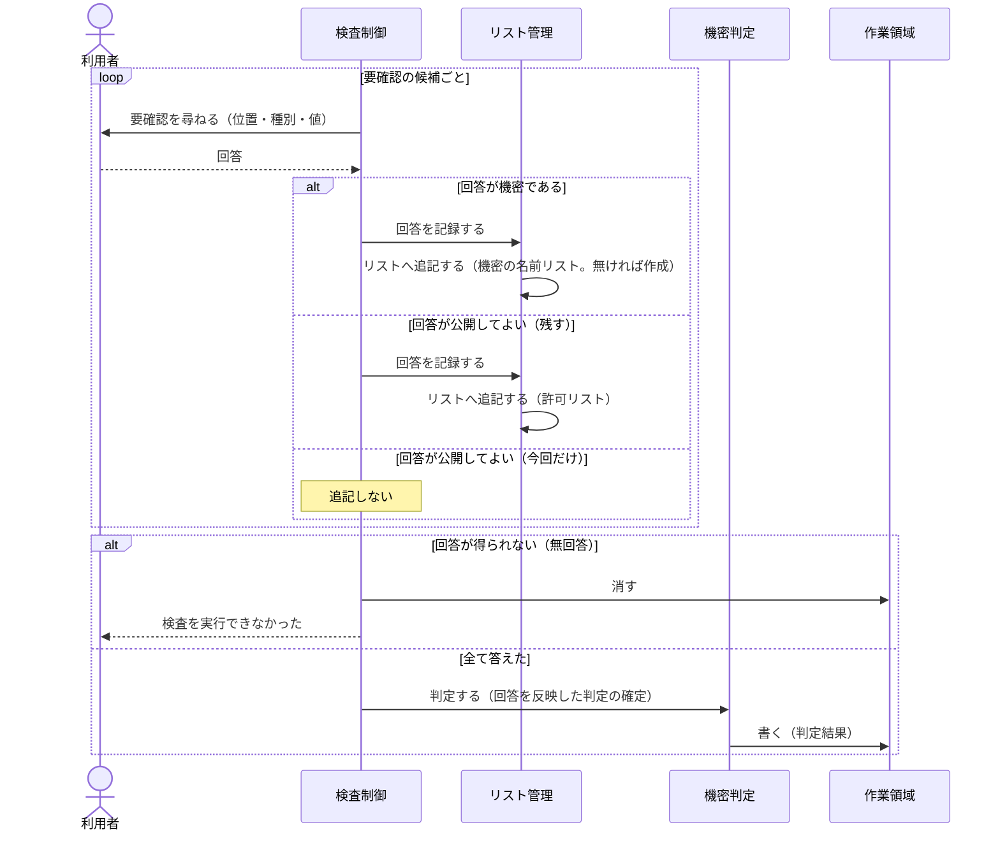

# DES-087 secret-linter（機密情報の検査）設計書

## 概要

[REQ-032][req] を実現する設計である。外部へ出る直前の検査を、継承型 SKILL `secret-linter` が仕切り、決定論的な処理をスクリプトに、形式を持たない混入の検出をカスタム Agent に割り当てる。

## 入力で決まっていること

要件・プロジェクトのルール・規範文書で、最初から決まっているものを示す。設計はこれを手段として使う。

| 決まっていること                                                                                                              | 出典                                                                | 設計での扱い                                                        |
| ----------------------------------------------------------------------------------------------------------------------------- | ------------------------------------------------------------------- | ------------------------------------------------------------------- |
| 提供形態は SKILL `secret-linter`。呼び出し元は SKILL だけを窓口にする                                                         | REQ-032 概要、[実装ガイドライン][impl-guide]                        | 検査制御を継承型 SKILL にする。呼び出し元はスクリプトを直接呼ばない |
| パターンによる検出は、スクリプトによる決定論的な処理で行う                                                                    | REQ-032 FNC-3002                                                    | パターン検出をスクリプトにする                                      |
| AI による検出は、サブエージェントを起動して行う                                                                               | REQ-032 FNC-3002、[Claude Code 作成ガイド][authoring-guide]         | AI 検出をカスタム Agent にする（隔離 context が要る処理）           |
| 処理ロジックは SKILL.md に書かず、スクリプトにする。Python は標準ライブラリのみ（PyYAML は可）。スクリプトにはテスト必須      | [実装ガイドライン][impl-guide]                                      | 検出・判定・リスト操作をスクリプトにする                            |
| 終了コードは 0（完了）・1（失敗）・2（引数）を共通の意味とする。所見が 0 件や不合格は完了であり、中身は標準出力の JSON で返す | [script のエラー出力][script-error]                                 | 「不合格」は完了、「検査を実行できなかった」は完了しない            |
| Agent とのデータ受け渡しは識別値だけを運び、データはスクリプトが書く。AI は JSON を組み立てない。終わったら削除する           | [agent とのデータ受け渡し][agent-exchange]                          | 検査の作業領域をスクリプトが作り、終了時に消す                      |
| 対話 session の Agent は background で動き、AskUserQuestion を持てない（観測）                                                | [Claude Code リファレンス][cc-reference]                            | 利用者への確認は継承型 SKILL の側で行う                             |
| 判定の区分条件・2 つのリストの意味・抑制マーカーは、規範文書が定める                                                          | REQ-032 概要、[規範文書][sensitive-spec]                            | 機密判定は、規範文書が定める区分条件・一致方法を実装する            |
| 引数は AI が解釈し、不正な値はスクリプトが受理しない（`argparse` の終了コード 2）                                             | [実装ガイドライン][impl-guide]、[script のエラー出力][script-error] | 語彙外の引数・複数の指定は「検査を実行できなかった」になる          |

## シナリオ表

`DSP-` は表示要件、`ERR-` はエラーケースの、参照用の ID である（要件定義書に ID が無いため、本書で振った）。対応は次のとおりである。

- `DSP-1`: 結果の内容（位置・種別・値・判定）と、呼び出し元へ返すもの。`DSP-2`: 結果をファイルに残さない。`DSP-3`: 抑制マーカーの件数と位置、スキップの表示。`DSP-4`: 通過した候補を、種別と値が同じものを 1 行にまとめて示す。`DSP-5`: 不合格のとき、誤検出を通す方法（抑制マーカー）を結果の末尾に示す
- `ERR-1`: 対象の指定が不正。`ERR-2`: git の実行の失敗。`ERR-3`: リストの形式が不正。`ERR-4`: AI による検出の応答が 2 回続けて出力形式に反した。`ERR-5`: 要確認の確認で、利用者が答えずに中断した
- 本書は、「中断」を結果で 2 つに分ける。**無回答**: 質問の結果が得られず、SKILL が続行できた場合（ERR-5）。`cleanup.py` を通り、検査を実行できなかったとして終わる。**打ち切り**: SKILL が続行できずに終わった場合。後始末が走らず、作業領域が残りうる。要件定義書の「中断」は、無回答を指す。ERR-4 の「出力形式に反した」は、W-3 の受理条件（`unit_id` が実在し、値が検査単位の本文にそのまま含まれる）を満たさないことを指す。

| ID    | 要件            | 型       | きっかけ／条件                                                   | 応答                                                                                                                                                | 関係する非機能要件 |
| ----- | --------------- | -------- | ---------------------------------------------------------------- | --------------------------------------------------------------------------------------------------------------------------------------------------- | ------------------ |
| SC-01 | FNC-3001, 3007  | イベント | 範囲の指定 1 つ（省略時 `--diff`）と任意の `--rules-only` で起動 | 範囲を解決し、検出と判定を行って結果を返す                                                                                                          |                    |
| SC-02 | FNC-3001        | 異常     | 対象が 0 件                                                      | 合格を返す（エラーにしない）                                                                                                                        |                    |
| SC-03 | FNC-3001        | 常時     | ファイルを検査する                                               | 全体を検査する。`--branch` は履歴の追加行とコミットメッセージ                                                                                       |                    |
| SC-04 | FNC-3002        | 常時     | 検査する                                                         | パターンによる検出を、スクリプトで決定論的に行う                                                                                                    | 速さ優先           |
| SC-05 | FNC-3002        | 任意機能 | `--rules-only` が無い                                            | AI による検出を、全ての指定で行う                                                                                                                   |                    |
| SC-06 | FNC-3002, ERR-4 | 異常     | AI の応答が出力形式に反する                                      | 1 回だけやり直し、再度反したら「検査を実行できなかった」                                                                                            |                    |
| SC-07 | FNC-3003        | イベント | 機密候補が得られた                                               | 不合格・要確認・通過に判定する。1 件でも不合格なら全体が不合格                                                                                      |                    |
| SC-08 | FNC-3003, 3005  | イベント | 要確認がある                                                     | 利用者に確認し、回答に従ってリストへ追記する。メールアドレスは完全一致の項目だけで通る                                                              |                    |
| SC-09 | FNC-3004        | 状態     | `~/.project-secret.yaml` が無い間                                | 空のリストとして扱い、最初の「機密である」の回答で作成する                                                                                          |                    |
| SC-13 | FNC-3007        | イベント | 検査が終わった                                                   | 合格・不合格・検査を実行できなかった、を区別して返す                                                                                                |                    |
| SC-14 | DSP-1, DSP-2    | 常時     | 結果を示す                                                       | 値は元のまま利用者に示し、呼び出し元が受け取る判定結果は区分だけにする。結果はファイルに残さない                                                    |                    |
| SC-15 | DSP-3, 4, 5     | 常時     | 結果を示す                                                       | 抑制マーカーの件数・位置と、スキップしたファイルと理由を示す。通過した候補を種別と値ごとに 1 行にまとめ、不合格なら抑制マーカーの案内を末尾に添える |                    |
| SC-16 | ERR-1, 2, 3     | 異常     | 指定が不正・git が失敗・リストの形式が不正                       | 「検査を実行できなかった」として終了し、理由を示す                                                                                                  |                    |
| SC-17 | ERR-5           | 異常     | 要確認の確認で、利用者が答えずに中断した                         | 「検査を実行できなかった」として終了する                                                                                                            |                    |

常時型（SC-03・04・14・15）は図にせず、関係するアクターの契約の事前条件・事後条件で扱う。

## 上流の設計

### クラス定義

| 責務名                     | 保持データ（実質保持を含む）                                                                                                                                                 | メソッド                                                                                      | 協調相手                         | 要件ID                     |
| -------------------------- | ---------------------------------------------------------------------------------------------------------------------------------------------------------------------------- | --------------------------------------------------------------------------------------------- | -------------------------------- | -------------------------- |
| 検査制御（SKILL）          | 検査 ID、検査要求（範囲の指定・`--rules-only`）                                                                                                                              | 起動する、AI 検出を依頼して待つ、要確認を尋ねる                                               | 全てのクラス、利用者、呼び出し元 | FNC-3001, 3003, 3005, 3007 |
| 対象解決                   | 検査単位（`<<file>>` 作業領域。正本は作業領域）                                                                                                                              | 範囲を解決する                                                                                | 作業領域                         | FNC-3001                   |
| パターン検出（スクリプト） | パターン定義（既知の形式・形式の手がかり）、抑制マーカー                                                                                                                     | 検出する                                                                                      | 作業領域                         | FNC-3002, DSP-3            |
| AI 検出（カスタム Agent）  | なし（検査 ID だけを受け取る）                                                                                                                                               | 検出する                                                                                      | 作業領域                         | FNC-3002                   |
| リスト管理                 | 許可リスト（`<<file>>` 同梱分〔公開のドメイン・公開の開発系パッケージの接頭辞〕と `.secret-linter/allowlist.yaml`）、機密の名前リスト（`<<file>>` `~/.project-secret.yaml`） | 読む、回答を記録する                                                                          | 機密判定                         | FNC-3003, 3004             |
| 機密判定                   | 判定規則（正本は規範文書）                                                                                                                                                   | 判定する                                                                                      | リスト管理、作業領域             | FNC-3003                   |
| 結果提示                   | なし                                                                                                                                                                         | 示す                                                                                          | 作業領域                         | DSP-1, 2, 3, 4, 5          |
| 作業領域                   | 検査単位・機密候補・判定結果（`<<file>>` 検査 ID ごとの置き場。1 回の検査の間だけ存在する）                                                                                  | 作る、書く、検査単位のパスを返す、AI の候補を受け付ける、終了の印を書く、終了を確かめる、消す | 全てのクラス                     | FNC-3002, DSP-2            |

- 責務名の「パターン検出」「AI 検出」は、要件定義書の用語「パターンによる検出」「AI による検出」を行う責務の短縮名である。
- 1 文での説明: 検査制御は検査の流れを仕切る。対象解決は検査する範囲を決める。パターン検出は形式で候補を見つける。AI 検出は形式を持たない候補を見つける。リスト管理は 2 つのリストを読み書きする。機密判定は候補を区分する。結果提示は結果を利用者に示す。作業領域は 1 回の検査の間だけ受け渡しデータを置く。
- 「検査制御（SKILL）」「パターン検出（スクリプト）」「AI 検出（カスタム Agent）」は、手段が入力で決まっている。他の責務の手段は、詳細設計で決める。
- 呼び出し元（本機能を呼ぶ他のスキル）と利用者は設計の外にあるアクターである。

### クラス図

### シーケンス図

#### 検査の流れ（SC-01・02・03・04・07・13・14・15・16）

#### AI による検出（SC-05・06）

#### 要確認の確認とリストへの追記（SC-08・09）

### 共有データ定義

| データ名         | 意味                                                                                                                                                                    | 正本                                                                             | 書き手                                    | 読み手                       | ライフサイクル                                                                                 | 同時アクセスの約束                                                                                   |
| ---------------- | ----------------------------------------------------------------------------------------------------------------------------------------------------------------------- | -------------------------------------------------------------------------------- | ----------------------------------------- | ---------------------------- | ---------------------------------------------------------------------------------------------- | ---------------------------------------------------------------------------------------------------- |
| 検査要求         | 範囲の指定 1 つと、任意の `--rules-only`                                                                                                                                | 呼び出し元の引数                                                                 | 利用者・呼び出し元                        | 検査制御、対象解決           | 1 回の検査の間                                                                                 | なし                                                                                                 |
| 作業領域         | 1 回の検査の受け渡しデータの置き場。検査 ID で一意に決まる                                                                                                              | 作業領域                                                                         | 作業領域                                  | 全てのクラス                 | 検査の開始で作り、終了で消す（失敗した経路でも消す。打ち切りの場合を除く）。作成者だけが読める | 実行ごとに別の置き場を使い、並行する検査が互いに干渉しない                                           |
| 検査単位         | 検査する本文の 1 件。位置と本文を持つ。ファイル全体、または履歴の追加行・コミットメッセージ                                                                             | 作業領域                                                                         | 対象解決                                  | パターン検出、AI 検出        | 範囲の解決から検査の終了まで                                                                   | なし                                                                                                 |
| 機密候補         | 機密の疑いがある値。位置・種別・値・出どころ（パターン／AI）を持つ                                                                                                      | 作業領域                                                                         | パターン検出、AI 検出（作業領域を介して） | 機密判定                     | 検出から検査の終了まで                                                                         | パターンと AI は別々に書く。互いの候補を上書きしない                                                 |
| 許可リスト       | 公開してよいと確認した値・ドメイン・URL・パッケージの接頭辞。同梱分（公開のドメイン・公開の開発系パッケージの接頭辞）と、プロジェクトの `.secret-linter/allowlist.yaml` | 同梱分は本プラグインのファイル、プロジェクト分は `.secret-linter/allowlist.yaml` | リスト管理（回答の記録）                  | 機密判定                     | 「公開してよい（残す）」の回答で追記される                                                     | 追記は一時ファイルから置き換える。同時追記で項目が失われても、次の検査で再び要確認になるだけで安全側 |
| 機密の名前リスト | 外へ出してはならない値。利用者のホームの `~/.project-secret.yaml`                                                                                                       | `~/.project-secret.yaml`                                                         | リスト管理（回答の記録）                  | 機密判定                     | 無いときは空として扱い、最初の「機密である」の回答で作る                                       | 同上                                                                                                 |
| 判定結果         | 候補ごとの区分（不合格・要確認・通過）、全体の区分、要確認の一覧、抑制の件数と位置、スキップの一覧                                                                      | 作業領域                                                                         | 機密判定                                  | 検査制御、結果提示           | 判定から検査の終了まで。要確認の回答ごとに、新しい判定結果を書き足す（最新のものが現在の判定） | なし                                                                                                 |
| 終了の印         | AI 検出が正常に終えたことを示す印（`ai_done.json`）                                                                                                                     | 作業領域                                                                         | 作業領域（AI 検出の終了の報告を受けて）   | 検査制御（作業領域を介して） | AI 検出が全ての報告を受理されて終えたときだけ書く。検査の終了で消す                            | なし                                                                                                 |
| 検査の区分       | 呼び出し元へ返す結果。合格・不合格・検査を実行できなかった。値を含めない                                                                                                | 検査制御の最終応答                                                               | 検査制御                                  | 呼び出し元                   | 検査の終了で 1 つ返す                                                                          | なし                                                                                                 |

### モジュール表

契約の行は、アクターが他のアクターから受け取るメッセージである。内部の行は、契約を果たすための自己メッセージである。

| ID  | アクター     | 区分 | 処理                     | 呼び出し元         | 種別                      | 入力（何を・取得元）                                                                                 | 処理概要                                                                                                                                                                                                                                                                                                    | 出力（何を・保存先）                                        | 事前条件                                                                    | 事後条件                                                                                                                                                                                          | 失敗時                                                                                                                                            | 要件ID                   |
| --- | ------------ | ---- | ------------------------ | ------------------ | ------------------------- | ---------------------------------------------------------------------------------------------------- | ----------------------------------------------------------------------------------------------------------------------------------------------------------------------------------------------------------------------------------------------------------------------------------------------------------- | ----------------------------------------------------------- | --------------------------------------------------------------------------- | ------------------------------------------------------------------------------------------------------------------------------------------------------------------------------------------------- | ------------------------------------------------------------------------------------------------------------------------------------------------- | ------------------------ |
| K-1 | 検査制御     | 契約 | 起動する                 | 利用者、呼び出し元 | AI（継承型 SKILL）        | 検査要求（検査要求）                                                                                 | 引数を検査要求に落とし、検査の流れを進める。区分を 1 つ返す                                                                                                                                                                                                                                                 | 検査の区分（検査の区分）。利用者へは R-1 の結果             | 検査対象が git リポジトリの中にある（`--files` の外部の一時ファイルを除く） | 検査が終わる、または検査を実行できなかったと決まる経路では、作業領域が消えている（打ち切りの場合は、後始末をせずに終わり、残りうる）。区分が 1 つだけ返っている。呼び出し元へ返した区分に値が無い | 指定の不正・git 失敗・リストの形式不正・AI 検出の不成立・要確認の中断は、検査を実行できなかったとして、理由（値を除く）を示して終える             | FNC-3001, 3007, DSP-1, 2 |
| K-2 | 検査制御     | 内部 | AI 検出を依頼して待つ    | K-1                | AI（継承型 SKILL）        | 検査 ID                                                                                              | `--rules-only` では A-1 を起動せず、速さを優先する。`--rules-only` でなければ A-1 を起動し、完了通知を受けるまで先へ進まない。終えたかは W-4 で確かめ、自分で判断しない                                                                                                                                     | 作業領域の AI の候補（機密候補）                            | 検査単位が書かれている                                                      | AI の候補が作業領域にあるか、検査を実行できなかったと決まっている                                                                                                                                 | W-4 が「終えていない」なら検査を実行できなかったとして終える                                                                                      | FNC-3002                 |
| K-3 | 検査制御     | 内部 | 要確認を尋ねる           | K-1                | ユーザ（AskUserQuestion） | 要確認の候補（判定結果）                                                                             | 候補ごとに位置・種別・値を示して回答を得る。メールアドレスも、他の候補と同じ 3 択にする                                                                                                                                                                                                                     | 回答（候補ごと）                                            | 要確認が 1 件以上ある                                                       | 全ての要確認に回答が付く                                                                                                                                                                          | 回答が得られなければ、合格にせず検査を実行できなかったとして終える                                                                                | FNC-3003, 3005, ERR-5    |
| T-1 | 対象解決     | 契約 | 範囲を解決する           | K-1                | クラス                    | 検査要求、リポジトリの状態                                                                           | `--diff`: ステージ済み・未ステージ・未追跡の変更ファイルの全体（削除は対象外、`.gitignore` を尊重）。`--branch`: リモートに無い commit の追加行とメッセージ。`--files`: 指定ファイルの全体。`--dirs`: 配下のファイルの全体（`.gitignore` を尊重）。読めないものは理由付きで記録する                         | 検査単位（検査単位）。読めなかったものの一覧（判定結果へ）  | 範囲の指定が 1 つだけ。検査要求が正しい形である                             | 0 件を含め、検査単位が作業領域に書かれている。ファイルを部分で検査していない（`--branch` の追加行を除く）                                                                                         | 指定が不正（不在のファイル・ディレクトリ・複数の指定・語彙外の引数）または git が失敗したら、作業領域を作っていれば消してから、理由を返して終える | FNC-3001, ERR-1, 2       |
| P-1 | パターン検出 | 契約 | 検出する                 | K-1                | Script                    | 検査単位（検査単位）                                                                                 | 既知の形式と、形式の手がかり（法人格の表記を伴う会社名・散文中のパスワード・言い換えたドメインや IP・アプリのパッケージ名）に一致する値を機械的に検出する。抑制マーカー付きの行は候補にせず、件数と位置を数える                                                                                             | 機密候補（出どころ=パターン）、抑制の件数と位置（作業領域） | 検査単位が書かれている                                                      | 同じ検査単位には、常に同じ機密候補を出す（決定論）。AI を使わない                                                                                                                                 | 実行できなければ、検査を実行できなかったとして終える                                                                                              | FNC-3002, DSP-3          |
| A-1 | AI 検出      | 契約 | 検出する                 | K-2                | AI（カスタム Agent）      | 検査 ID                                                                                              | 検査単位を読み、形式を持たない混入（個人名・法人格の表記の無い会社名・リソース名等）の機密候補を探し、W-3 で報告する。合否を決めない                                                                                                                                                                        | 機密候補（出どころ=AI）、終了の印（作業領域）               | 検査単位が書かれている                                                      | 出力に含まれるのは位置・種別・値だけで、区分を含まない。全ての報告が W-3 に受理された時だけ終了の印が残る                                                                                         | W-3 に拒否されたら 1 回だけ報告し直す。再度拒否されたら終了の印を書かずに終える                                                                   | FNC-3002, ERR-4          |
| A-2 | AI 検出      | 内部 | 形式を持たない混入を探す | A-1                | AI                        | 検査単位                                                                                             | 本文を読み、機密の疑いがある値を挙げる                                                                                                                                                                                                                                                                      | 候補の一覧（A-1 が W-3 へ渡す）                             | 検査単位を読める                                                            | 挙げた値は、区分を持たない機密候補である                                                                                                                                                          | 揺れは契約の外へ漏らさない（下記「AI の契約」）                                                                                                   | FNC-3002                 |
| L-1 | リスト管理   | 契約 | 読む                     | K-1                | クラス                    | 許可リスト（同梱分と `.secret-linter/allowlist.yaml`）、機密の名前リスト（`~/.project-secret.yaml`） | 2 つのリストを読み、形式を検査する。`~/.project-secret.yaml` が無いときは空のリストとして扱う                                                                                                                                                                                                               | 2 つのリストの内容                                          | なし（ファイルが無いのは異常ではない）                                      | 形式が正しいリストだけが返る                                                                                                                                                                      | 形式が不正なら、行番号を返して終える（値は返さない）                                                                                              | FNC-3004, ERR-3          |
| L-2 | リスト管理   | 契約 | 回答を記録する           | K-1                | クラス                    | 回答（機密である・公開してよい（残す）・公開してよい（今回だけ））、候補の値                         | 機密である→機密の名前リストへ追記（無ければ作成）。公開してよい（残す）→許可リストへ追記。今回だけ→追記しない。メールアドレスも同じ（残すと、そのアドレスを許可リストへ追記する）                                                                                                                           | 更新したリスト（許可リスト、機密の名前リスト）              | 回答が定められた選択肢のどれかである                                        | 追記で既存の項目が失われない（一時ファイルから置き換える）。次に L-1 で読んだとき、追記した値が含まれる                                                                                           | 書き込めなければ、検査を実行できなかったとして終える                                                                                              | FNC-3003, 3004           |
| L-3 | リスト管理   | 内部 | リストへ追記する         | L-2                | クラス                    | 追記する値、追記先のリスト                                                                           | 追記先のリストの全体を読み、末尾に項目を加えた全体を一時ファイルへ書いてから置き換える。`~/.project-secret.yaml` が無ければ作成する                                                                                                                                                                         | 更新したリストのファイル                                    | リストの形式が正しい                                                        | 既存の項目が失われていない。追記した値が 1 回だけ含まれる                                                                                                                                         | 書き込めなければ L-2 の失敗時に従う                                                                                                               | FNC-3003, 3004           |
| J-1 | 機密判定     | 契約 | 判定する                 | K-1                | クラス                    | 機密候補（作業領域）、2 つのリスト（リスト管理）、本書の区分条件・一致方法                           | 候補ごとに不合格・要確認・通過へ分ける。両方のリストに一致したら機密の名前リストを優先する。メールアドレス（予約値を除く）は、許可リストの完全一致の項目があれば通過、無ければ要確認にする。1 件でも不合格なら全体を不合格にする。自動修正はしない                                                          | 判定結果（判定結果）。要確認の一覧を含む                    | 機密候補と 2 つのリストが揃っている                                         | 同じ入力には、常に同じ判定を出す（決定論）。AI の出力は合否を決めず、候補として扱われている                                                                                                       | 実行できなければ、検査を実行できなかったとして終える                                                                                              | FNC-3003, 3004           |
| R-1 | 結果提示     | 契約 | 示す                     | K-1                | クラス                    | 判定結果（作業領域）                                                                                 | 位置（履歴なら commit も）・種別・値（元の文字列のまま）・判定、通過した候補（種別と値が同じものを 1 行にまとめ、件数と最初の位置を示す）、抑制マーカー付きの件数と位置、読めずにスキップしたものと理由を、利用者に示す。不合格のときは、誤検出を通す方法（抑制マーカー）を末尾に添える。ファイルに残さない | 利用者への表示                                              | 判定が確定している                                                          | 呼び出し元へ返す区分に値が含まれていない。結果が作業領域の外のファイルに残っていない                                                                                                              | 示せなければ、検査を実行できなかったとして終える                                                                                                  | DSP-1, 2, 3, 4, 5        |
| W-1 | 作業領域     | 契約 | 作る                     | K-1                | クラス                    | なし                                                                                                 | 実行ごとに一意な置き場を作り、検査 ID を返す。作成者だけが読める                                                                                                                                                                                                                                            | 検査 ID                                                     | なし                                                                        | 検査 ID から置き場が決まる                                                                                                                                                                        | 作れなければ、検査を実行できなかったとして終える                                                                                                  | FNC-3002, DSP-2          |
| W-2 | 作業領域     | 契約 | 書く                     | T-1, P-1, J-1      | クラス                    | 検査 ID、書く内容（検査単位・機密候補・判定結果）                                                    | 値を生成・要約・改変せずに置く。完成後に 1 回で公開する                                                                                                                                                                                                                                                     | 作業領域の内容                                              | W-1 で作られている                                                          | 書いた内容が、渡したものと同一である                                                                                                                                                              | 書けなければ、検査を実行できなかったとして終える                                                                                                  | FNC-3002                 |
| W-3 | 作業領域     | 契約 | AI の候補を受け付ける    | A-1                | クラス                    | 検査 ID、候補（位置・種別・値）                                                                      | 候補の位置と値が、検査単位の本文と対応するかを検査し、受理したものだけを AI の機密候補として書く                                                                                                                                                                                                            | AI の機密候補（作業領域）                                   | W-1 で作られている                                                          | 受理した候補は区分を持たない。本文と対応しないものは書かれていない                                                                                                                                | 本文と対応しない報告は拒否し、理由を返す                                                                                                          | FNC-3002, ERR-4          |
| W-4 | 作業領域     | 契約 | 終了を確かめる           | K-2                | クラス                    | 検査 ID                                                                                              | AI 検出が正常に終えたことを示す印があるかを返す                                                                                                                                                                                                                                                             | 終えた／終えていない                                        | W-1 で作られている                                                          | 印が無い（書かれなかった・落ちた・起動できなかった）場合は、すべて「終えていない」になる                                                                                                          | なし                                                                                                                                              | FNC-3002, ERR-4          |
| W-5 | 作業領域     | 契約 | 消す                     | K-1                | クラス                    | 検査 ID                                                                                              | 置き場の中身をすべて削除する                                                                                                                                                                                                                                                                                | なし                                                        | なし（置き場が無くても成功する）                                            | 検査の結果と値が、ファイルとして残っていない                                                                                                                                                      | 消せなければ、残っている旨を利用者に伝える                                                                                                        | DSP-2                    |
| W-6 | 作業領域     | 契約 | 検査単位のパスを返す     | A-1                | クラス                    | 検査 ID                                                                                              | 検査単位の一覧ファイルの絶対パスを返す。本文は返さない                                                                                                                                                                                                                                                      | 一覧ファイルの絶対パス                                      | W-1 で作られ、検査単位が書かれている                                        | 返したパスのファイルを、そのまま読める                                                                                                                                                            | 作業領域が無ければ、理由を返す                                                                                                                    | FNC-3002                 |
| W-7 | 作業領域     | 契約 | 終了の印を書く           | A-1                | クラス                    | 検査 ID                                                                                              | AI の機密候補が全て受理され、拒否が 2 回続いていないときだけ、終了の印（封緘）を書く                                                                                                                                                                                                                        | 終了の印（作業領域）                                        | W-1 で作られている                                                          | 印があるのは、AI 検出が正常に終えたときだけである                                                                                                                                                 | 拒否が 2 回続いた後は、印を書かずに理由を返す                                                                                                     | FNC-3002, ERR-4          |

#### AI の契約（A-1・A-2）

AI で実現する処理に、次の 3 つを定める。出力のスキーマは詳細設計で書く。

- **出力に何が含まれるか**: 位置・種別・値だけである。区分（不合格・要確認・通過）は含まない。合否は機密判定が決める。
- **検証方法**: 作業領域が、報告の位置と値が検査単位の本文と対応するかを検査する（W-3）。対応しない報告は書かれない。正常に終えたことは終了の印で確かめる（W-4）。AI や検査制御の AI が成否を判断しない。
- **結果が揺れたときの対策**: 拒否されたら 1 回だけ報告し直す。再度拒否されたら終了の印が残らず、検査を実行できなかったことになる。見落とし・誤検出は契約の外へ出さない。誤検出は機密判定で「要確認」になり、利用者の確認に落ちる。

## 既存の実装・設計との照合

上流の設計の責務・契約・共有データを手がかりに、既存の実装と設計を探した結果である。修正せずに使えるものは、詳細設計で手段として使う。修正を前提にするものの扱い（移設・改修・削除）は、設計ではなく実装戦略書が決める。

### 見つけたものと判断

| 既存                                                                                                               | 内容                                                                                                                                                                                  | 修正せずに使えるか                                                                                                                                                                                                                                                                                                               | 設計への反映                                                                                                                                 |
| ------------------------------------------------------------------------------------------------------------------ | ------------------------------------------------------------------------------------------------------------------------------------------------------------------------------------- | -------------------------------------------------------------------------------------------------------------------------------------------------------------------------------------------------------------------------------------------------------------------------------------------------------------------------------- | -------------------------------------------------------------------------------------------------------------------------------------------- |
| forge プラグインの `skills/review/scripts/resolve_targets.py`                                                      | review の対象軸（diff・branch・files・dirs）の解決。`get_diff_targets` は未 commit の変更と未追跡ファイルを、削除を除いて返す。`get_dir_targets` は `.gitignore` を尊重して配下を返す | `--diff` と `--dirs` の列挙は、REQ-032 の定義と一致する。ただし、secret-linter は他スキルの部品に依存しない構成にする（REQ-032 の前提条件）ため、この部品そのものは使わない。`--files` は、プロジェクトルート外のパスを拒否するため使えない（REQ-032 は外部の一時ファイルを含む）。`--branch` は base との分岐を取るため使えない | T-1 の `--diff` と `--dirs` は、この 2 つの関数と同じ挙動の列挙を、secret-linter の scripts に置いた独立した部品（`git_targets.py`）で行う   |
| forge プラグインの `scripts/review/`（`publish_request.py`、`reviewer_*.py`、`review_common.py`）と reviewer Agent | 識別値だけを運び、script が書き、読み手はパスを得て直接読む。結果は確定してから書き、終了の値で封緘する。置き場はプロジェクト内の `.temp/review/`                                     | 依頼・所見のスキーマが review 固有のため、そのままは使えない                                                                                                                                                                                                                                                                     | 受け渡しの型は、同じ規範に従う兄弟機能のパターンとして採る（上流の設計と一致するため、再設計は不要）。置き場は採らない（下記「手段の決定」） |
| forge プラグインの `scripts/forge_settings.py`                                                                     | `.claude/.forge.yaml` を読む。制約付き YAML のサブセットを標準ライブラリで解析し、エラーには行位置と理由だけを載せる                                                                  | 使えない。返すのは mapping であり、トップレベルが文字列リストのファイルを扱う契約ではない。置き場も `.claude/` で、REQ-032 の `.secret-linter/` と異なる                                                                                                                                                                         | 同じ方針（標準ライブラリで解析し、エラーに値を載せない）を、リスト管理に採る                                                                 |

### 型の判定

| 型                 | 判定 | 根拠                                                                                                               |
| ------------------ | ---- | ------------------------------------------------------------------------------------------------------------------ |
| 完全新規（設計）   | 否   | 設計書がプロジェクトに 24 件ある                                                                                   |
| 純粋追加型（設計） | 該当 | 既存の設計書のどれも変更せず、重複・矛盾もしない。機密情報の検査をレビューから分離する方針は、REQ-027 が定めている |
| 差分開発型（設計） | 否   | 変更する既存の設計書が無い                                                                                         |

## 詳細設計

### 手段の決定

| アクター                                                         | 手段                                                                                                       | 理由                                                                                                                                                                                                    |
| ---------------------------------------------------------------- | ---------------------------------------------------------------------------------------------------------- | ------------------------------------------------------------------------------------------------------------------------------------------------------------------------------------------------------- |
| 検査制御                                                         | 継承型 SKILL `linter/skills/secret-linter/SKILL.md`。引数を AI が解釈してスクリプトを順に呼ぶ              | 入力で決まっている（REQ-032、実装ガイドライン）。判断のないロジックは持たず、SKILL はスクリプトを呼ぶ順序と、AI にしかできない 2 つ（利用者への質問、Agent の起動）だけを持つ                           |
| 対象解決・パターン検出・リスト管理・機密判定・結果提示・作業領域 | Python スクリプト（`linter/skills/secret-linter/scripts/`）。標準ライブラリのみ                            | 決定論的に完結する処理は、スクリプトにする（Claude Code 作成ガイドの起動経路の選び方）。`git` は subprocess で呼ぶ                                                                                      |
| AI 検出                                                          | カスタム Agent `linter:secret-reader`（`linter/agents/secret-reader.md`）。tools は Read・Grep・Glob・Bash | 隔離 context が要る処理（ファイルを読む重い処理を、呼び出し元の context へ入れない）。reviewer・evaluator と同じ構成。利用者への質問を持てないため、質問は検査制御が行う                                |
| 作業領域の置き場                                                 | プロジェクトの外の一時領域（OS の一時ディレクトリの下）。検査ごとに一意な、作成者だけが読めるディレクトリ  | 作業領域は機密の値を含む。プロジェクト内（`.temp/review/` のような置き場）は、利用者環境で `.gitignore` されている保証がなく、commit に混入しうる。受け渡しは script が書くため、プロジェクト外へ書ける |
| YAML のリスト                                                    | 標準ライブラリで書いた、文字列リストだけの制約付きパーサー                                                 | PyYAML のエラーメッセージは該当行の内容を含み、REQ-032 の「行番号を示す（値は示さない）」を満たせない。形式を文字列リストに絞れば、標準ライブラリで足りる                                               |

### スクリプトの契約

作業領域の識別値（検査 ID）は、`scan.py` が生成して返し、以後の呼び出しはこれだけを運ぶ。終了コードは、プロジェクトの規則に従う。0 は依頼された操作が完了したこと（「不合格」を含む。中身は標準出力の JSON）、1 は完了しなかったこと（標準出力の `errors` に理由）、2 は引数を受理できないこと（`argparse`）である。1 と 2 は、検査制御が「検査を実行できなかった」として扱う。

| スクリプト     | 担うモジュール     | 呼ぶ主体 | 引数                                                                                                                            | 成功時の標準出力（終了コード 0）                                                                                          | 1 を返す条件                                                                                  |
| -------------- | ------------------ | -------- | ------------------------------------------------------------------------------------------------------------------------------- | ------------------------------------------------------------------------------------------------------------------------- | --------------------------------------------------------------------------------------------- |
| `scan.py`      | W-1, T-1, P-1, W-2 | 検査制御 | 範囲の指定 1 つ（`--diff` / `--branch` / `--files パス…` / `--dirs パス…`）、`--project-root` 絶対パス                          | 検査 ID、検査単位の件数、パターンの機密候補の件数                                                                         | 指定したファイル・ディレクトリが無い。git が失敗した。作業領域を作れない                      |
| `ai_units.py`  | A-1 の入力         | AI 検出  | 検査 ID                                                                                                                         | 検査単位の一覧ファイルの絶対パス                                                                                          | 検査 ID の作業領域が無い                                                                      |
| `ai_add.py`    | W-3                | AI 検出  | 検査 ID、`--unit-id`、`--line`（任意）、`--kind`。標準入力に値（1 件ずつ呼ぶ）                                                  | 受理した件数                                                                                                              | 候補を検証できない（下記）。2 回続けて拒否された後の呼び出し                                  |
| `ai_finish.py` | A-1 の終了の印     | AI 検出  | 検査 ID                                                                                                                         | 空の成功                                                                                                                  | 作業領域が無い。拒否が 2 回続いた後（印は書かない）                                           |
| `ai_check.py`  | W-4                | 検査制御 | 検査 ID                                                                                                                         | AI 検出が正常に終えたこと                                                                                                 | 終了の印が無い                                                                                |
| `judge.py`     | L-1, J-1, W-2      | 検査制御 | 検査 ID、`--project-root` 絶対パス、`--rules-only`（任意）                                                                      | 全体の区分（合格・不合格・要確認の残り）、要確認の候補の一覧（候補 ID・位置・種別・値）、抑制の件数と位置、スキップの一覧 | リストの形式が不正（行番号を返し、値は返さない）。`--rules-only` でなく AI 検出が終えていない |
| `answer.py`    | L-2, J-1, W-2      | 検査制御 | 検査 ID、`--project-root` 絶対パス、`--answer 候補ID=回答`（候補ごとに繰り返す。回答は `secret`・`public-keep`・`public-once`） | `judge.py` と同じ形（回答を反映した判定）                                                                                 | 回答が選択肢に無い。リストへ書き込めない                                                      |
| `report.py`    | R-1                | 検査制御 | 検査 ID                                                                                                                         | 区分（合格・不合格）と、利用者へ示す結果の本文                                                                            | 判定が確定していない                                                                          |
| `cleanup.py`   | W-5                | 検査制御 | 検査 ID                                                                                                                         | 空の成功（作業領域が無くても成功する）                                                                                    | 削除できない                                                                                  |

- `scan.py` は、1 を返すとき、作った作業領域を自分で消してから返す。失敗時は検査 ID を返さず、検査制御が `cleanup.py` に渡せないためである。
- `scan.py` の範囲の指定は、`argparse` の排他グループにする。複数の指定・語彙外の引数は終了コード 2 になる。指定が無いときは `--diff` とする。
- `judge.py` と `answer.py` の `--project-root` は、プロジェクトの許可リスト（プロジェクトルート配下のファイル）を探すために使う。検査制御は、`scan.py` に渡したものと同じ値を渡す。
- 各スクリプトは、module docstring に終了コードの表を置く。`3` 以上は使わない。
- 呼び出し元が受け取る区分は、SKILL の最終行である。最終行は次の 3 つのいずれかの 1 行だけで、値を含めない。
  - `secret-linter: 合格`
  - `secret-linter: 不合格`
  - `secret-linter: 検査を実行できなかった（理由）`

#### SKILL が呼ぶ順序

| 順 | 呼ぶもの                                         | 条件                                              | 結果の扱い                                                                                                                                                                       |
| -- | ------------------------------------------------ | ------------------------------------------------- | -------------------------------------------------------------------------------------------------------------------------------------------------------------------------------- |
| 1  | `scan.py`                                        | 常に                                              | 終了コードが 0 以外なら、検査を実行できなかったとして、最終行だけを返す（`scan.py` が自分の作業領域を消しているため、`cleanup.py` は呼ばない）。検査単位が 0 件なら 8 へ（合格） |
| 2  | `linter:secret-reader` を Agent ツールで起動する | `--rules-only` でないとき                         | 完了通知を受けるまで先へ進まない。`ScheduleWakeup` で待たない                                                                                                                    |
| 3  | `ai_check.py`                                    | 2 を行ったとき                                    | 0 以外なら 8 へ（検査を実行できなかった）                                                                                                                                        |
| 4  | `judge.py`                                       | 常に（`--rules-only` のときは、その指定を付ける） | 0 以外なら 8 へ（検査を実行できなかった）                                                                                                                                        |
| 5  | 利用者に質問する（AskUserQuestion）              | 要確認が残るとき                                  | 種別と値が同じ候補は 1 件にまとめる。1 回の質問は 4 件までのため、4 件ずつ尋ねる。無回答なら 8 へ（検査を実行できなかった）                                                      |
| 6  | `answer.py`                                      | 5 を行ったとき                                    | 回答は、まとめた全ての候補 ID に付けて渡す。0 以外なら 8 へ（検査を実行できなかった）。要確認が残れば 5 へ戻る                                                                   |
| 7  | `report.py`                                      | 判定が確定したとき                                | 結果の本文を、そのまま利用者に示す                                                                                                                                               |
| 8  | `cleanup.py`、最終行                             | 常に（失敗した経路でも通る）                      | 区分を最終行として 1 行で返す                                                                                                                                                    |

### 構造の定義

#### 作業領域の中身

置き場は検査 ID から決まる。ファイルは、内容が確定してから 1 回の操作で公開する（一時ファイルへ書いてから、既存のファイルを置き換えない形で公開する）。書いた後は、上書き・修正しない。変わるもの（AI の候補の追加、拒否、判定の更新）は、書くたびに新しい連番のファイルにする。

| ファイル              | 書き手                  | 内容                                                                                                                               |
| --------------------- | ----------------------- | ---------------------------------------------------------------------------------------------------------------------------------- |
| `units.json`          | `scan.py`               | 検査単位の配列と、読めずにスキップしたものの配列                                                                                   |
| `pattern.json`        | `scan.py`               | パターンの機密候補の配列、抑制マーカー付きの件数と位置、プレースホルダ等として除外した件数                                         |
| `ai_events/NNNN.json` | `ai_add.py`             | `ai_add.py` の 1 回の呼び出しの結果（連番）。受理なら機密候補 1 件、拒否なら拒否の旨と理由。末尾に連なる拒否の数が、拒否の連続回数 |
| `ai_done.json`        | `ai_finish.py`          | 終了の印。`"exit": "0"` だけを持つ。`ai_finish.py` が成功したときだけ書かれる                                                      |
| `judgment/NNNN.json`  | `judge.py`、`answer.py` | 候補ごとの区分と、全体の区分（連番）。`judge.py` が 0001 を、`answer.py` が回答のたびに次の番号を書く。最も大きい番号が現在の判定  |

- 検査単位（`units.json` の要素）: `unit_id`、`kind`（`file`・`added_lines`・`commit_message`）、`label`（パス。`commit_message` は固定の語 `コミットメッセージ`）、`commit`（`added_lines` と `commit_message` のとき、その commit の識別子。`label` に詰めて解釈し直さず、独立した項目として持つ。識別子の長さ・形式には依存しない）、`text_path`（本文のファイルの絶対パス）、`line_numbers`（`added_lines` のとき、本文の各行に対応する、元のファイルの行番号）。`file` は元のファイルをそのまま `text_path` にする（本文を複製しない）。`added_lines` と `commit_message` は、作業領域へ書く。
- 機密候補: `candidate_id`、`source`（`pattern`・`ai`）、`unit_id`、`line`（無ければ `null`）、`kind`、`value`、`commit`（履歴のとき）。
- `kind` の語彙は閉じた集合である。
  - パターン: `known_token`・`private_key`・`connection_string`・`jwt`・`secret_assignment`・`password_prose`・`high_entropy`・`company_hint`・`obfuscated_host`・`package_name`・`domain`・`email`・`private_ip`・`internal_host`
  - AI: `person_name`・`company_name`・`resource_name`・`other_ai`
- 判定結果: 候補ごとに `candidate_id`、`class`（`fail`・`confirm`・`pass`）、`reason`（どの規則で決まったか）。全体は、1 件でも `fail` があれば `fail`。なければ、`confirm` が残る間は `confirm`、すべて `pass` なら `pass`。

#### リストのファイル

- 形式: 文字列だけのブロックリスト（`- 項目` を 1 行に 1 つ）。コメント行（`#` で始まる行）と空行を許す。項目は、引用符なし、または `"` か `'` で囲む。これ以外の書式（入れ子・複数行・アンカー・flow style）は、形式不正にする。
- 形式不正のエラーは、行番号と理由だけを返す。行の内容は返さない。
- 同梱の許可リスト（公開ドメイン・公開の開発系パッケージの接頭辞）は、`linter/skills/secret-linter/assets/` に置く。種類ごとにファイルを分ける。ドメインの項目の内容は、実装で定める。パッケージの接頭辞は、`org.apache`・`org.eclipse`・`org.junit`・`org.jetbrains`・`org.springframework`・`org.slf4j`・`org.gradle`・`org.mozilla`・`org.w3c`・`org.xml`・`com.apple`・`com.google`・`com.android`・`com.microsoft`・`com.facebook`・`com.squareup`・`com.sun`・`com.oracle`・`com.fasterxml`・`com.amazonaws`・`com.jetbrains`・`io.flutter`・`io.netty`・`io.reactivex`・`io.grpc`・`io.micrometer`・`io.opentelemetry`・`net.java`・`net.sf` とする。個人や組織が自分で持つ名前の領域（`io.github`・`com.github` 等）は入れない。
- 追記は、同じディレクトリの一時ファイルへ全体を書いてから置き換える。

#### AI 検出の入出力

- 入力: 検査 ID だけ。検査単位のパスは `ai_units.py` から得る。
- 出力: 候補 1 件ごとに `ai_add.py` を 1 回呼ぶ。位置と種別は引数（`--unit-id`・`--line`（任意）・`--kind`）で、値は標準入力の文字列で渡す。`ai_add.py` は Bash の 1 回の実行につき 1 件だけ呼び、複数を 1 つのコマンドに並べない（拒否の結果を読んでから、1 回だけ立て直すため）。AI は JSON を組み立てない。構造（`ai_events/NNNN.json`）は script が作る。`--kind` の語彙は `person_name`・`company_name`・`resource_name`・`other_ai` で、`argparse` の選択肢にする。
- `ai_add.py` が候補を受理する条件（引数と本文の対応関係の検査だけを置く）:
  - `unit_id` が実在すること。
  - `value` が、その検査単位の本文（`line` があればその行）に、そのまま含まれること。AI が作った値を、ここで拒否する。
- 拒否が連続した回数は、`ai_events/` の末尾に連なる拒否の数である。受理が 1 件あれば 0 に戻る。2 回続けて拒否された後は、`ai_add.py` も `ai_finish.py` も拒否し、`ai_done.json` は書かれない。
- Agent の最終応答は、終えたことだけを述べる。値は含めない（最終応答は呼び出し元の context に入るため）。

### 詳細なアルゴリズム

#### 対象解決（T-1）

- `--diff`: secret-linter の `git_targets.get_diff_targets` を使う。ステージ済み・未ステージ・未追跡の変更ファイル（削除を除く）を返す。
- `--dirs`: secret-linter の `git_targets.get_dir_targets` を使う。`git ls-files --cached --others --exclude-standard` で、`.gitignore` を尊重する。
- `--files`: 指定されたファイルの全体。プロジェクトルートの外のパスも受け付ける。実在しなければ失敗にする。
- `--branch`: リモートに無い commit の履歴を検査する。
  1. 範囲は `HEAD --not --remotes`（リモートが無ければ全履歴）。
  2. 追加行は、マージ commit を除く commit の `git log -p -U0` から得る。hunk の見出し（`@@ -a,b +c,d @@`）から、追加行の元の行番号を求める。ファイルが削除された commit、バイナリ（`Binary files … differ`）は、読めないものとして記録する。
  3. コミットメッセージは、マージ commit を含む全ての commit から得る。
  4. 出力の区切りは、実行ごとに生成した乱数の文字列にする。メッセージや diff の内容と衝突させない。
  5. git が引用符で囲んだパスは、元のパスへ戻す。
- NUL バイトを含むファイル、読めないファイルは、読めないものとして理由付きで記録する。ファイルの大きさでは除外しない（除外すると、巨大なファイルの中の機密が、検査されないまま合格になるため）。1 行が長いときは、行を重なりのある窓に分けて、行の終わりまで検査する（P-1）。

#### パターン検出（P-1）

行ごとに、次の順で検出する。同じ行・同じ値は、最初に一致した規則だけを採る。採用した値の部分文字列も除く。

1. 行末に `secrets-scan: ignore` を含む行は、候補にせず、件数と位置を数える。マーカー自体は走査から除く。
2. 既知の形式: プレフィックス付きのトークン、秘密鍵ブロック、資格情報を埋め込んだ接続文字列、JWT。
3. 秘密らしいキーへの代入。値が、プレースホルダ・コード式・定数名・パスに見えるキーのものは、候補にせず除外件数に数える。
4. 散文中のパスワード（`パスワードは〇〇`・`password is 〇〇` 等）。バッククォートで囲んだコード片は、文章に書かれたパスワードではないため、候補にしない（他の規則が、コード片の中の既知の形式や代入を検出する）。
5. 高エントロピー文字列（40 文字以上、16 進数だけのものを除く。エントロピーの閾値は暫定値（4.5）とする。TBD-D1）。
6. 形式の手がかり: 法人格の表記を伴う会社名（`株式会社〇〇` 等）、言い換えたドメイン・IP（`〇〇 dot 〇〇`、`〇〇[.]〇〇` 等）、アプリのパッケージ名（`package_name`）。パッケージ名は、先頭のラベルが逆ドメインの根になる語（`com`・`org`・`net`・`io`・`jp`・`co`・`edu`・`gov`。大文字小文字を区別しない。`app`・`dev`・`me`・`ai`・`info`・`biz` は、`app.module.ts`・`ai.model.config.json` のようなファイル名・設定名の先頭にも現れて誤検出を招くため、根にしない）で、3 つ以上のラベルを `.` でつないだ識別子である。各ラベルは英字で始まり、英数字と `_` だけ。クラス名が続く形（`com.〇〇.〇〇.MainActivity`）も、全体を 1 つの値にする。規則 7 のドメインが末尾の `.dev`・`.app` を接尾辞とみなして重ねて拾わないよう、7 より前に置く。
7. §2.2 の種別: ドメイン・メールアドレス・プライベート IP・内部ホスト名。

- 文書用の予約値（`localhost`、`example.com` 等）と許可リストの扱いは、検出では除かない。判定で「通過」にする（規範文書が区分を定めるため、判定を 1 か所にする）。予約ドメインを逆にしたパッケージ名（`com.example.app` 等）も同じである。検出で除くと、同じ値が規則 7 のドメイン（末尾が `.app`）として拾われるため、`package_name` として採ったうえで判定が通過にする。
- パターン一覧（正規表現）の具体は、実装で定める。上記は検出する種別と除外の方針である。

#### 機密判定（J-1）

候補ごとに、次の順で最初に当たったものを採る。

1. 機密の名前リストに一致する → `fail`。
2. `kind` が `package_name` で、予約ドメインを逆にした形 → `pass`（理由は文書用の予約値と同じ）。同梱の許可リストの接頭辞に一致 → `pass`（理由は `allowlist_bundled_package`。同梱のドメインの理由 `allowlist_bundled_full`・`allowlist_bundled_host_only` と並べる）。プロジェクトの許可リストの `接頭辞.*` の項目に一致 → `pass`（理由は `allowlist_project`）。`fail` の種別が予約値と許可リストを通す唯一の例外である。
3. `kind` が `fail` の種別 → `fail`。
4. 文書用の予約値 → `pass`。
5. メールアドレスで、許可リストに完全一致の項目がある → `pass`（理由は許可リストの一致と同じ）。
6. メールアドレス（上に当たらないもの） → `confirm`。
7. 許可リストに一致する → `pass`。
8. `kind` が `confirm` の種別 → `confirm`。

メールアドレスは、`kind` が `email` のもの、または値全体がメールアドレスの形のもの（AI の候補を含む）である。実在する個人の情報でありうるため、プロジェクトの許可リストの完全一致の項目だけで通し、ドメインの項目・`*.` の項目・同梱の公開ドメインでは通さない（個人のアドレスを一括で許さない）。逆に、メールアドレスの項目は完全一致でしか一致しないため、ドメインの候補を通さない。

- 種別と区分の対応は、規範文書（§7.2）が定める。判定は、これを実装する。
- 文書用の予約値は、規範文書（§7.3）が定める固定の一覧である。判定の規則（J-1）が、この一覧を 1 か所だけに持つ。
- リストの一致方法は、規範文書（§8.2）が定める。同梱の許可リストは、規範文書が区別する 3 種類（パスまで公開のドメイン・ホストだけ公開のドメイン・公開の開発系パッケージの接頭辞）を、種類ごとにファイルを分けて持つ。
- 通過の候補は、結果の表示で、種別と値が同じものを 1 行にまとめる（件数と最初の位置を示す）。`fail` と `confirm` は、候補ごとに示す。大量の URL を含む対象でも、利用者と呼び出し元の context に入る量を抑えるためである。

#### 結果提示（R-1）

`report.py` は、区分と本文を JSON で返す。本文は、不合格・要確認の回答後の結果を候補ごとに（位置、履歴なら commit、種別、値、判定）、通過をまとめて、抑制マーカー付きの件数と位置、読めずにスキップしたものと理由、の順に並べる。区分が不合格のときは、最後に、誤検出を通す方法（行末の抑制マーカー）の案内を 1 つ添える（示さなければ、利用者も呼び出し元の AI も、止まったまま打つ手を知らない）。検査制御は、本文をそのまま利用者に示す。

### 利用ライブラリ

標準ライブラリだけを使う（`argparse`・`json`・`re`・`math`・`subprocess`・`tempfile`・`os`・`pathlib`・`uuid`）。外部ライブラリは使わない。理由は、プラグインのランタイムは標準ライブラリのみとする規則による。YAML は、上記のとおり自前の制約付きパーサーにする。

### 動作の原理

- **作業領域の安全性**: 置き場の作成は `mkdir`（モード 0700）で行う。既に在れば、別の検査 ID で作り直す。並行する検査は、互いの置き場に触れない。置き場は検査の間だけ在り、最終行の前に `cleanup.py` が消す。失敗した経路も、同じ最終工程を通る。
- **打ち切りでの残留**: 検査が打ち切られると、後始末をせずに終わり、作業領域が残りうる。残った作業領域は、OS の一時領域に、作成者だけが読める権限で置かれている。エラーと無回答は、利用者へ報告して終わる。
- **AI の揺れが外へ漏れない**: AI の候補は、検査単位に実在する値だけが受理される。区分は機密判定が決めるため、AI の誤検出は「要確認」になり、利用者の確認に落ちる。見落としは、機密の名前リストに登録した後の検査から止まる。
- **成否を AI に判断させない**: AI 検出が正常に終えたことは、封緘（`"exit": "0"`）の有無で `ai_check.py` が判定する。落ちた・黙って終えた・拒否が続いた場合は、すべて封緘が無く、同じ「検査を実行できなかった」に収束する。
- **履歴を取りこぼさない**: `--branch` は、作業ツリーではなく履歴（`git log -p`）を見る。途中の commit で入れて後で消した値も、履歴の追加行として検査される。区切りに乱数を使うため、本文の内容に引きずられない。
- **同時書き込み**: リストの追記は、置き換えで行う。同時に追記して項目が失われても、次の検査で再び「要確認」になるだけで、機密を通す方向には働かない。

### テスト

- スクリプトごとにテストを置く（`tests/` に、スキル名で分類）。対象は、範囲の解決（`--diff`・`--branch`・`--files`・`--dirs`、0 件、不在）、パターン検出（各種別、除外、抑制マーカー）、リストの解析（形式不正の行番号、値が出ないこと）、判定の順序、`ai_add.py` の検証と連続拒否、封緘、作業領域の消去。
- Agent の判断（形式を持たない混入を見つけられるか）は、`ai_tests/` に Markdown で置き、手動で実行する。
- SKILL.md はテストが困難なため、SKILL の手順（質問・Agent の起動・最終行）は、手順の確認で検証する。

検証する主体は、次の 3 つである。**S**: スクリプトのテスト（`tests/`）。**A**: Agent の手動テスト（`ai_tests/`）。**K**: SKILL の手順の確認（`/linter:secret-linter` を実際に起動する）。

| シナリオ | 検証する主体 | 検証すること                                                                                                                                                                                                                                                                                                                                                                        |
| -------- | ------------ | ----------------------------------------------------------------------------------------------------------------------------------------------------------------------------------------------------------------------------------------------------------------------------------------------------------------------------------------------------------------------------------- |
| SC-01    | S・K         | 範囲の指定 1 つ（省略時 `--diff`）の受理と、語彙外・複数の指定の拒否（S）。呼ぶ順序（K）                                                                                                                                                                                                                                                                                            |
| SC-02    | S・K         | 対象 0 件で、検査単位が 0 件になること（S）。合格が返ること（K）                                                                                                                                                                                                                                                                                                                    |
| SC-03    | S            | `--files`・`--dirs` は全体、`--branch` は追加行とコミットメッセージが、検査単位になること。ファイルの大きさでは除外されないこと                                                                                                                                                                                                                                                     |
| SC-04    | S            | 各種別の検出（`package_name` は、クラス名が続く形・`.dev` 付きの形・`domain` と重ならないこと・2 ラベルを拾わないこと・根の語（`com`・`org`・`net`・`io`・`jp`・`co`・`edu`・`gov`）で検出し、外した根の語（`app.module.ts` 等）では検出しないことを含む）、除外、同じ入力で同じ出力（決定論）、1 行が長くても行末まで検出され、窓の境目をまたぐ値も欠けずに 1 件だけ検出されること |
| SC-05    | A・K         | 形式を持たない混入を見つけること（A）。`--rules-only` の有無による起動の違い（K）                                                                                                                                                                                                                                                                                                   |
| SC-06    | S            | 本文と対応しない報告の拒否、2 回連続の拒否後は終了の印が書かれず、`ai_check.py` が失敗すること                                                                                                                                                                                                                                                                                      |
| SC-07    | S            | 判定の順序（予約ドメインを逆にしたパッケージ名の通過、同梱・プロジェクトのパッケージの接頭辞の通過とラベルの境界、機密の名前リストが優先されることを含む）、1 件でも不合格なら全体が不合格、同じ入力で同じ判定                                                                                                                                                                      |
| SC-08    | S・K         | 回答に応じたリストの追記（S）。質問の提示と、メールアドレスも 3 択になること（K）                                                                                                                                                                                                                                                                                                   |
| SC-09    | S            | `~/.project-secret.yaml` が無いとき空として扱い、最初の「機密である」で作成すること（ホームは一時ディレクトリにする）                                                                                                                                                                                                                                                               |
| SC-13    | S・K         | 区分の出力（S）。最終行が 3 つのいずれかの 1 行で、値を含まないこと（K）                                                                                                                                                                                                                                                                                                            |
| SC-14    | S            | 値が元のまま示され、呼び出し元へ返る区分に値が含まれず、作業領域の外にファイルが残らないこと                                                                                                                                                                                                                                                                                        |
| SC-15    | S            | 抑制マーカー付きの件数と位置、スキップの一覧と理由が示されること                                                                                                                                                                                                                                                                                                                    |
| SC-16    | S            | 指定の不正・git の失敗・リストの形式不正で、検査を実行できなかったとなり、理由に値が含まれず、作業領域が消えること（`scan.py` 失敗時を含む）                                                                                                                                                                                                                                        |
| SC-17    | K            | 無回答のとき、`cleanup.py` を通り、検査を実行できなかったとして終わること                                                                                                                                                                                                                                                                                                           |

### 未確定事項

| ID     | 内容                                                                                                        | 扱い                                                                             |
| ------ | ----------------------------------------------------------------------------------------------------------- | -------------------------------------------------------------------------------- |
| TBD-D1 | 高エントロピー文字列の閾値（4.5）は暫定値である。本機能の対象（履歴・外部の本文）に妥当かは、確かめていない | 実運用の誤検出・見落としを見て調整する。必要なら要件定義書の未確定事項として扱う |

## 整合性の確認

### 追跡表

| 要件                            | それを満たす設計要素                                                                                                                                   |
| ------------------------------- | ------------------------------------------------------------------------------------------------------------------------------------------------------ |
| FNC-3001 対象の指定             | SC-01・02・03、K-1、T-1、`scan.py` の契約、「対象解決（T-1）」                                                                                         |
| FNC-3002 検出（速さ優先を含む） | SC-04・05・06、P-1、A-1・A-2、W-3・W-4・W-6・W-7、K-2（`--rules-only` で AI 検出を省く）、「パターン検出（P-1）」、「AI 検出の入出力」、「動作の原理」 |
| FNC-3003 機密判定と確認         | SC-07・08、J-1、K-3、L-2・L-3、「機密判定（J-1）」、「SKILL が呼ぶ順序」の 4〜6                                                                        |
| FNC-3004 2 つのリスト           | SC-09、L-1・L-2・L-3、「リストのファイル」、共有データの許可リスト・機密の名前リスト                                                                   |
| FNC-3005 確認の主体             | SC-08、K-3、K-1（返す区分）、「手段の決定」（質問は検査制御が行う）                                                                                    |
| FNC-3007 起動と結果の返却       | SC-01・13、K-1、「スクリプトの契約」（終了コードと最終行）                                                                                             |
| DSP-1                           | SC-14、R-1、「結果提示（R-1）」                                                                                                                        |
| DSP-2                           | SC-14、R-1・W-5、「動作の原理」（作業領域）                                                                                                            |
| DSP-3                           | SC-15、P-1・T-1・R-1                                                                                                                                   |
| DSP-4・DSP-5                    | SC-15、R-1、「結果提示（R-1）」                                                                                                                        |
| ERR-1・ERR-2                    | SC-16、T-1、`scan.py` が 1 を返す条件                                                                                                                  |
| ERR-3                           | SC-16、L-1、「リストのファイル」（行番号だけを返す）                                                                                                   |
| ERR-4                           | SC-06、A-1、W-3・W-4・W-7、「AI 検出の入出力」                                                                                                         |
| ERR-5                           | SC-17、K-3、「SKILL が呼ぶ順序」の 5                                                                                                                   |

要件定義書の「前提条件」「対象外」には、設計要素を置かない（対象外は設計しない）。

### チェック項目の結果

| 項目                                                                  | 結果                                                                            |
| --------------------------------------------------------------------- | ------------------------------------------------------------------------------- |
| 全ての要件に、設計要素が 1 つ以上ある                                 | 満たす（追跡表）                                                                |
| 常時型を除く全ての要件が、シーケンス図で演じられている                | 満たす（SC-01・02・05・06・07・08・09・13・16・17。常時型は SC-03・04・14・15） |
| 全ての異常型の要件が `alt` として現れている                           | 満たす                                                                          |
| 全ての非機能要件が、契約に反映されている                              | 満たす（速さ優先は K-2 と P-1）                                                 |
| 要件の概念を、用語集とは別の言葉で呼んでいない                        | 満たす                                                                          |
| 入力を書き換えていない                                                | 満たす                                                                          |
| 答えのない入力への質問が残っていない                                  | 満たす                                                                          |
| アクターに向かう矢印が全て、契約としてモジュール表にある              | 満たす                                                                          |
| クラスであるアクターの契約が、クラス図のメソッドと一致している        | 満たす                                                                          |
| 自己メッセージが全て、モジュール表に内部の処理としてある              | 満たす                                                                          |
| 共有データごとに、正本と書き手が明確である                            | 満たす                                                                          |
| AI で実現するもの全てに、出力・検証方法・揺れ対策・出力スキーマがある | 満たす（「AI の契約」と「AI 検出の入出力」）                                    |
| 詳細設計で決めたことに、理由が添えられている                          | 満たす                                                                          |
| 詳細設計が、契約の意味を変えていない                                  | 満たす                                                                          |
| Mermaid が描画できる                                                  | 静的検査は通した。描画の実パーサーでの確認は、していない                        |

[req]: ../requirements/REQ-032_secret-linter.md
[impl-guide]: ../../../rules/implementation_guidelines.md
[script-error]: ../../../rules/script_error_output_rules.md
[agent-exchange]: ../../../rules/agent_data_exchange_rules.md
[authoring-guide]: ../../../rules/claude_code_authoring_guide.md
[cc-reference]: ../../../rules/claude_code_reference.md
[sensitive-spec]: ../../../../linter/docs/sensitive_information_spec.md
